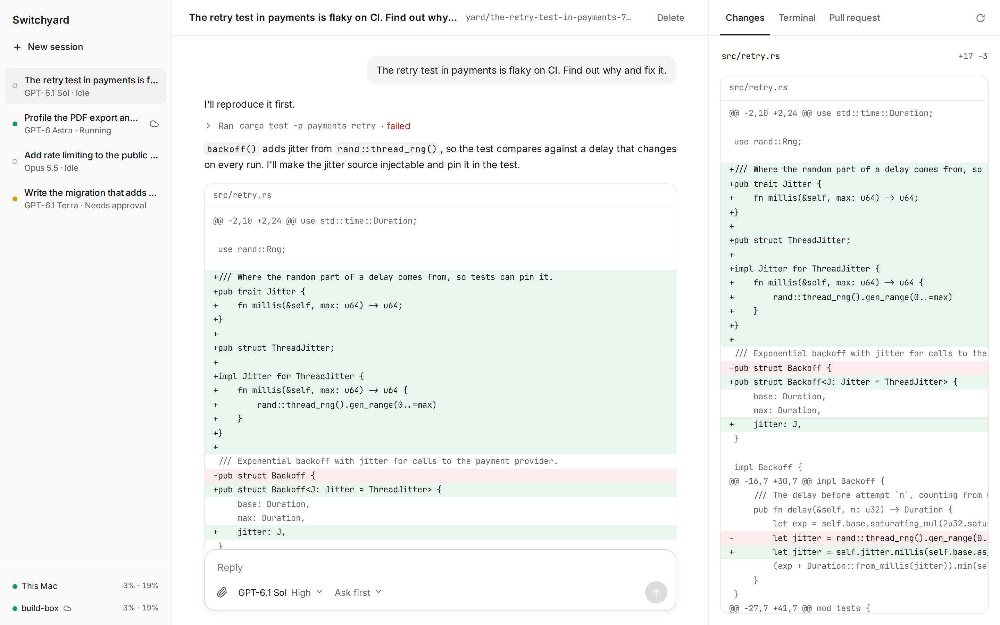
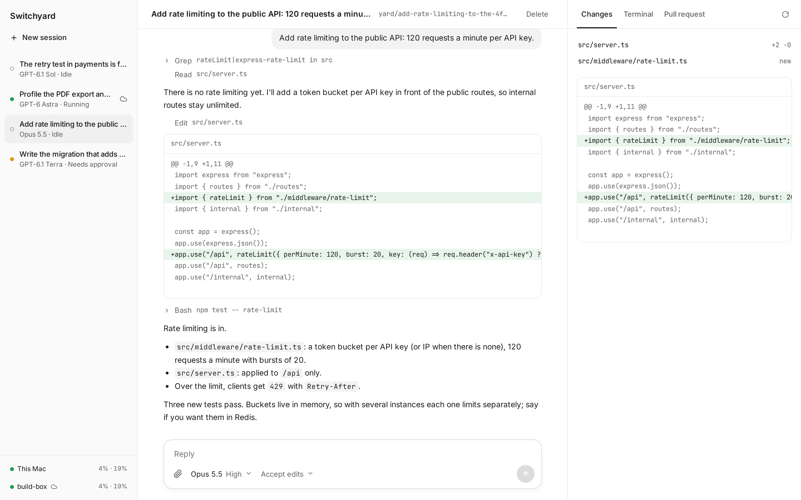
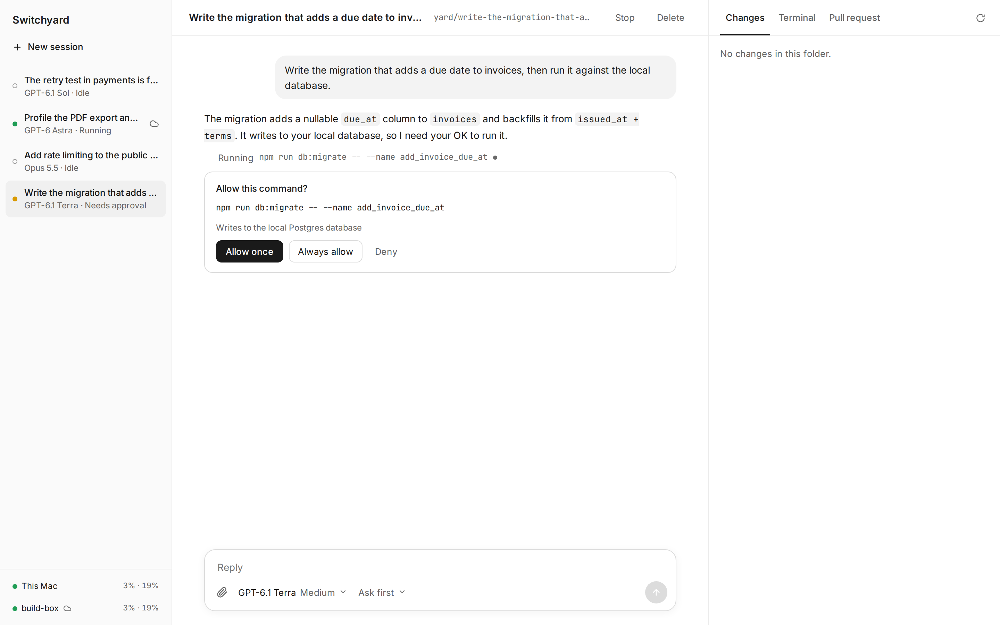
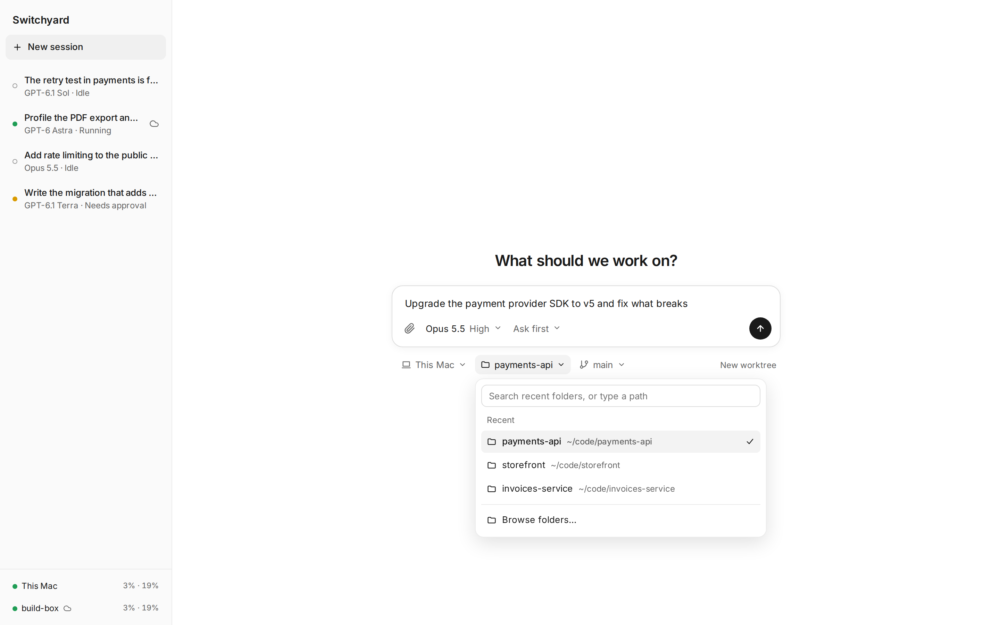
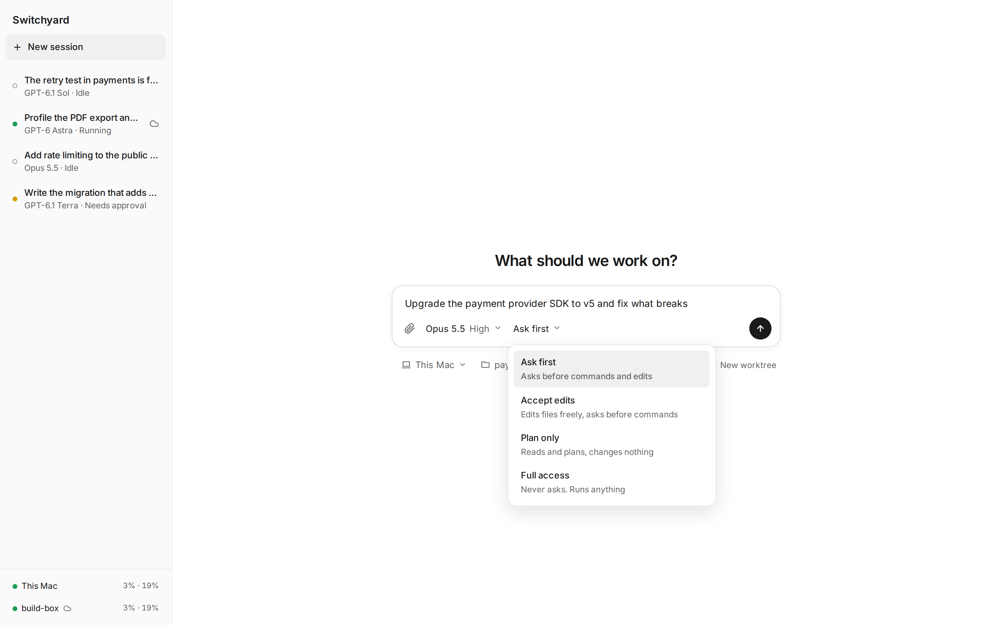
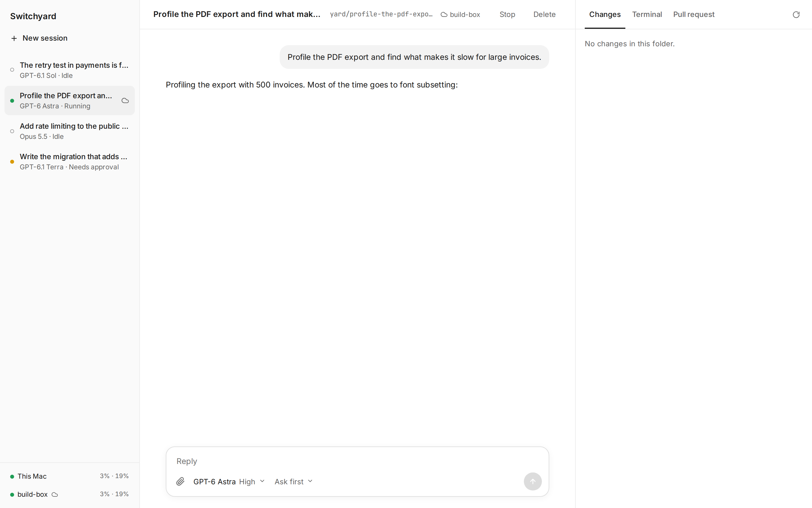
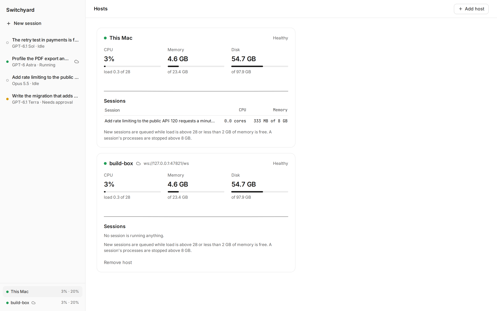

# Switchyard

**One window for Claude Code and Codex.** Run several agents side by side, on your Mac or on your own servers, switch models mid-conversation, and review every change before it lands.

Switchyard drives the `claude` and `codex` CLIs you already have, with the logins you already have. It never asks for an API key or a password, and nothing leaves your machines except what the CLIs themselves send.



<p align="center">
  <a href="https://github.com/giovaniif/better-than-claude-code/releases/latest/download/Switchyard.dmg"><b>Download for macOS</b></a>
  ·
  <a href="docs/web.md">Self-host the web version</a>
  ·
  <a href="docs/remote-hosts.md">Run sessions on a server</a>
  ·
  <a href="CONTRIBUTING.md">Build from source</a>
</p>

## What it does

**Both engines, one thread style.** Claude Code and Codex sessions look and work the same way: streamed answers, the commands each agent ran, its edits as diffs, and approvals inline. Switch models mid-session; picking the other engine's model hands the conversation off with a summary of the work so far.

**A worktree per session.** Every session in a git repository gets its own branch and worktree, so agents never trip over each other or your checkout. A Changes pane shows the diff, a Terminal pane gives you a shell in the same folder, and a Pull request pane shows the branch's PR, checks and review threads.

**Your servers too.** Add any machine you can `ssh` into and Switchyard installs itself there in one click. Its sessions sit in the same sidebar, with a cloud icon, and keep running when your laptop sleeps.

**Permission modes like Claude Code's.** Ask first, accept edits, plan only or full access, per session, switchable at any time.

**Files and images.** Paste, drop or attach them to any prompt. They are stored on the machine the session runs on, so screenshots reach a remote agent too.

**Guard rails for your machine.** CPU, memory and disk for every host are always on screen. New sessions wait while a machine is under pressure, and a session that eats too much memory is stopped.

<table>
  <tr>
    <td width="50%"></td>
    <td width="50%"></td>
  </tr>
  <tr>
    <td align="center">Claude Code with the same thread and diffs</td>
    <td align="center">Commands and edits wait for your approval</td>
  </tr>
  <tr>
    <td width="50%"></td>
    <td width="50%"></td>
  </tr>
  <tr>
    <td align="center">Start in any folder; each session gets a worktree</td>
    <td align="center">Permission modes per session</td>
  </tr>
  <tr>
    <td width="50%"></td>
    <td width="50%"></td>
  </tr>
  <tr>
    <td align="center">Sessions on a server, in the same sidebar</td>
    <td align="center">Every host's load at a glance</td>
  </tr>
</table>

## Get started

### Mac app

1. Install and log in to the engines you want: [Claude Code](https://docs.anthropic.com/en/docs/claude-code) (`claude`) and/or [Codex](https://github.com/openai/codex) (`codex`).
2. [Download Switchyard.dmg](https://github.com/giovaniif/better-than-claude-code/releases/latest/download/Switchyard.dmg), open it and drag Switchyard to Applications. It is signed and notarized, for Apple Silicon Macs.
3. Open it, describe a task, pick a folder and send.

Closing the window leaves your sessions running in the background, and they're all there when you open it again.

### On a server

Open **Hosts → Add host**, enter `you@your-server`, and click **Install Switchyard** when it offers. Details and troubleshooting: [docs/remote-hosts.md](docs/remote-hosts.md).

### In a browser

Switchyard also ships as one Docker image you can deploy with Coolify or Docker Compose and open from any browser. It has no sign-in of its own, so keep it on a private network such as a tailnet. See [docs/web.md](docs/web.md).

## How it works

```
 Switchyard window (Tauri)  ─┐
 or a browser                │  WebSocket
                             ▼
                  yardd (Rust, 127.0.0.1)  ── SQLite event log, worktrees, terminals
                   │        │         │
       codex app-server   yard-claude   ssh -L ──▶ yardd on your server
        (JSON-RPC)      (Agent SDK, Bun)              (same thing, remote)
```

- **yardd** owns every agent process and keeps each session's events in SQLite, so the UI can close, reload or reconnect without losing anything. It listens only on loopback and refuses browser origins other than its own page.
- **Codex** runs as one shared `codex app-server`; **Claude Code** runs through the Agent SDK in a small Bun sidecar per session. Both are normalized to the same events.
- **Remote hosts** are other yardds reached through an SSH tunnel the local one manages. Nothing new is exposed on the network.

The full design and its trade-offs are in [docs/ARCHITECTURE.md](docs/ARCHITECTURE.md).

## Status

Switchyard is young and moves fast. It runs on Apple Silicon Macs, with Linux (x64 or arm64) for remote hosts and the web version. The Claude Code side runs on the Agent SDK with your own CLI login, which suits personal use. If you build something for other people on top of it, read Anthropic's terms for the Agent SDK first.

## Contributing

Bug reports, ideas and pull requests are welcome. [CONTRIBUTING.md](CONTRIBUTING.md) covers building from source, the tests (which run without any account) and regenerating these screenshots.
